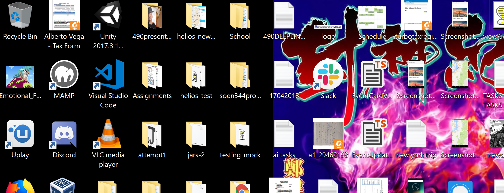

How good can I become at using Unity? Hopefully these tutorials will give me the answer.

There are two aspects I am exploring here. How can I make these entries journal-like? The other is the organization of my folder structures for the upcoming tutorials. As I am also attempting to give each of these tutorials some sort of unique use, I lose time figuring out the most boring part of this endeavour:

Management. But, better have it properly structured now, than losing even more time later on.

So chop...

...chop.

As the creeping realization that management might not be my strongest suit, I look over the title of the tutorial: "Game Objects and Scripts", and it involves making a clock. Simple enough.

The most boring variation I can think of for this tutorial is to make it into a game of stopping the clock at a certain time interval. After what feels an eternity, I manage some sort of project structure. How I miss having two monitors.

Aaaand...we are done with the tutorial. Quick refresher, this entry turned out to have a lot of "important notes" which made it less like a journal. For the variation on this tutorial, I will make an obstacle like course. Where the player needs to avoid the hands of the clock as time speeds up! Until next time!

Class notes

- Child objects are subject to the transformation of their parent object.
- Create different materials to make the assets distinct.
- An object's orientation is relative to its own local origin (position).
- Using the object's hierarchy to figure out positions around the scene.
- **What is a class?** Defines what data objects can contain and what functionality they have.
- Classes can define data and functionality that do not belong to objects, but to the class itself. Used to provide globally-available functionality.
- **Default access modifier for classes?** `internal class Clock`, which restricts access to the code from the same assembly. Relevant when using packaged code in multiple DLL files.
- **What does mono-behavior mean?** When missing, we cannot use the script to create a component in Unity. Unity can only use subtypes of MonoBehaviour to create components. The idea is that we can program our own components to add custom behavior to game objects.
- **Doesn't Awake have to be public?** Awake and other methods are special to Unity. It will find them and invoke them when appropriate.
- **What is a property?** It is a method that pretends to be a field. Might be read/write-only.
- **What is a structure?** A blueprint like a class. Instead it is a simple value like an integer or color instead of an object. It has no sense of identity. Use `struct`.
- **What is a quaternion?** Based on complex numbers to represent 3D rotations. Do not suffer from gimbal lock.
- **What's special about constants?** The `const` keyword indicates that a value will never change and does not need to be a field. Its value is computed during compilation and is substituted for all usage of the constant. Only possible for primitive types like numbers.
- **What's local about the rotation?** Refers to the actual rotation of a transform component, independent of its parents. Rotation in the object's local space.
- **What's a variable?** Acts like a field, except it exists only while a method is being executed. It belongs to the method not the class.
- **Is single precision enough?** For most games, yes. Becomes a problem when working with very large distances or scale differences.

