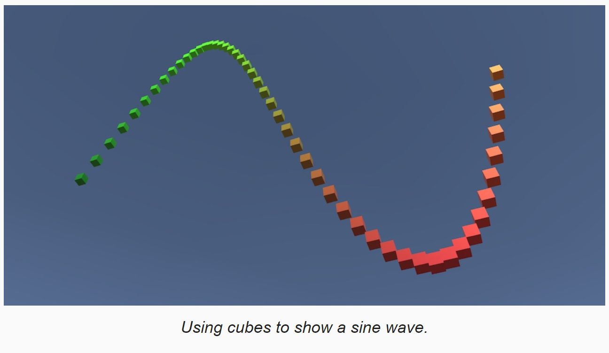

"Visualizing Math". A topic I have struggled with in the past. As they say, practice makes good. So, let's be good. I have decided to keep working on the tutorials, I will keep the unique twist development as a tertiary goal. No rush, I can only focus on so much at the time, and between improving my skills, developing my website and finding a job...let's just say that adding more concurrent goals can be counter productive. [Baby Steps](https://en.wikipedia.org/wiki/Baby_Steps), also a good manga by the way.

Back to today's topic, Building Graphs. I think it would be neat to make the graphs a road to traverse on. Because the tutorial uses cubes, it works perfectly as an obstacle already. Merely needing a player model that can jump as it moves along the graph.

Instantiating cube prefab *robot voice*. This whole tutorial makes me feel like I am back in class. Shaders! My last encounter with them was not very pleasant. So let's try again!

Class notes

- At its most fundamental level math is the manipulation of symbols that represent numbers. Solving an equation boils down to rewriting one set of symbols so it becomes another set of symbols.
- $f(x) = x + 1$ is easy to understand.
- $f(x) = (x - 1)^4 + 5x^3 - 8x^2 + 3x$ is harder.
- To understand the second function better we can represent the input-output pairs as two-dimensional coordinates in the form:

  $$
  \begin{bmatrix}x\\f(x)\end{bmatrix}
  $$

  A 2D vector where the top number represents the horizontal coordinate, x axis, and the bottom represents the vertical coordinate, y axis. $y = f(x)$.
- Particle systems or line segments can be used to build graphs. We will use cubes.
- Dragging an object towards the project window will create a prefab. A pre-fabricated game object that exists in the project but not on the scene.
- Changes to the prefabs affect all instances of it in any scene.
- Instances of prefabs use their own position and rotation.
- Game objects can have their properties modified which override the prefab's values. Many changes will break the relation between instance and prefab.
- Instantiating a game object is done via the `Instantiate` method.
- 3D vectors are created with the `Vector3` struct. Acts like a value not an object.
- **Why `i++` and not `++i`?** Because we want to increment i after evaluating first.
- **Can we change a vector's component individually?** Vector has three floating points x, y, z which are public.
- Vector types are mutable in Unity. Mutable vectors substitute three separate float values, which can be accessed independently, copied and assigned as a group.
- `Range` is an attribute type defined by Unity. Attributes are a way to attach metadata to code structures.
- GPU runs shader programs to render 3D objects.
- **How do surface shaders work?** Unity provides a framework to generate shaders that perform lighting calculations which values can be adjusted.
- **Albedo**: color of the diffuse reflectivity of a material. Describes how much red, green and blue color channels are diffusely reflected. The rest is absorbed.
- **Alpha**: measurement of opacity. At alpha 0 surface is fully transparent while at alpha 1 it is fully opaque.
- Using the tutorial's approach moving the graph would affect its color.
- Because colors cannot be negative, to get transitions from -1 to 1 we have to halve the x coordinates and add 0.5.
- **What is Mathf?** It is a struct that contains mathematical functions and constants to work with numbers and vectors.
- Sine wave oscillates between -1 and 1. It repeats every $2\pi$ units, which is roughly 6.28.
- To see the entire wave scale X by $\pi$ so we end up with $f(x) = \sin(\pi x)$.
- **What's a sine wave and $\pi$?** Google it.

