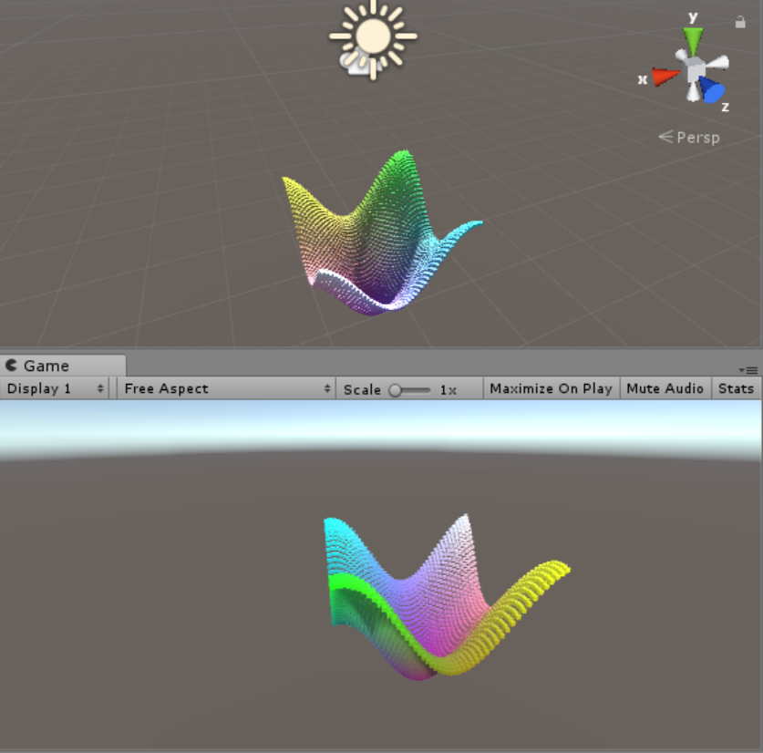
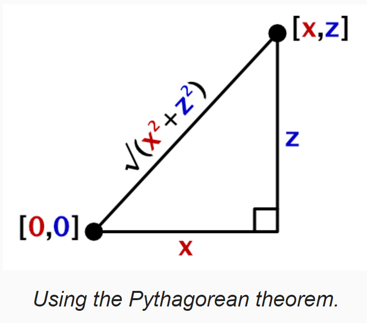
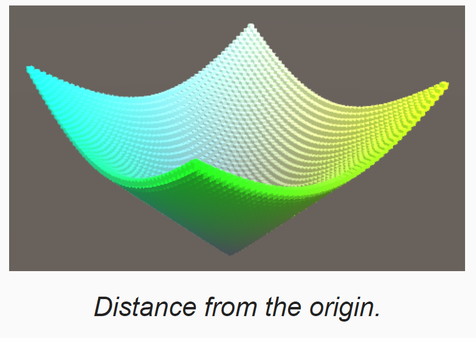
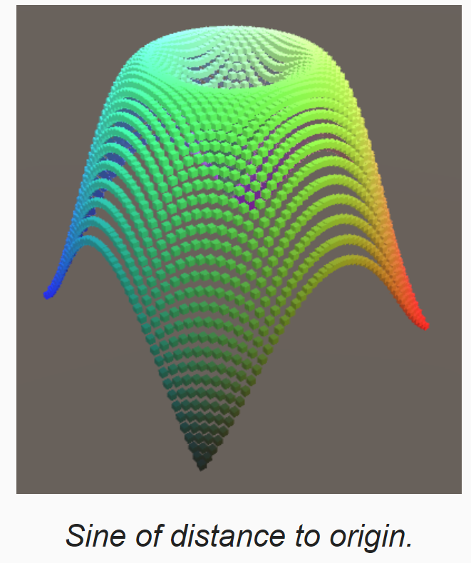

A new entry, a new challenge. I spent most of the morning fixing the modals on my journal. Now my "class notes" are displayed separately. "Mathematical Surfaces" is a continuation of the previous tutorial. No new project structures, and all that jazz.

Writing is hard. I am lost for words. Between building a website and working on other projects, there are a couple of things that are stuck in my mind.

- **Responsive design:** Still struggling with the implementation, trying to remind myself, mobile first.
- **Screen reader design:** Reflecting on accessibility.
- **Math.** Math. Math. Math. Math *to the beat of Rihanna's Work*
- **Preparing for code maintenance:** As I keep learning more, the quality of my code becomes apparent. So focusing on code structure as I go along is helping to minimize the work done when updating the code. Although, I did have to start my journal.html from scratch, but we do not talk about it.

Told a friend I was revising shaders, he told me to run away and hide. Encouragement! Lower the shields, knowledge incoming!

I think these mathematical functions could be fun as a course to overcome. The player tries to survive the longest.

We are done with the tutorial! Took much longer than anticipated. I added a UI menu to switch between the different functions from within the game.

Class notes

- By default, methods and fields are associated with specific object or value instances of a class or struct type. However, we can indicate that this association does not exist by using the `static` keyword.
- Using if-else for multifunctions is not convenient. By using a delegate type, you can store references to a method as a variable.
- **Delegate type:** defines the form of the methods that it can be used for. It is a method's signature, which is defined by its return type and parameter list.
- Enumerations can be created by defining an `enum` type. We can use an enumeration field to index our array.
- **Does it matter which dimension is used for the outer loop?** No, only the order in which the points have been created differs.
- For the 2D multi-sine function we used three waves: $f(x,z,t) = M + S_x + S_z$. M, the main wave, is slow-moving in a diagonal. $S_x$ is a normal wave and $S_z$ moves fast and has double the frequency. The final wave is $f(x,z,t) = 4M + S_x + S_z/2$, divided by 5.5 to normalize into the -1 to 1 range.
- Creating a ripple on a surface. The ripple spreads in all directions to get a circular pattern. Create a sine wave based on the distance from the origin. This distance can be found using the Pythagorean theorem $a^2 + b^2 = c^2$, where c is the length of the hypotenuse of a right angle triangle. In case of 2D points in the XZ plane, the hypotenuse is the line between the origin and that point. X and Z are the length of the other two sides. Making the distance of each of the points $\sqrt{x^2+z^2}$.

  
- By making $f(x,z,t)$ equal this distance, we get a cone.

  
- By making $f(x,z,t)$ a sine function we get a volcano shape.

  
- To reduce undulation we can reduce the amplitude of the wave. To mimic a ripple effect we can make it depend on the distance. By using $\frac{1}{10D}$ the ripple becomes weaker the further away it is. To avoid the amplitude becoming extreme near the origin we use $\frac{1}{1 + 10D}$.
- The wave moves outwards so we use $-t$.
- With the current approach no two points can have the same X and Z coordinates while having a different Y coordinate. The curvature of the surfaces is limited. Their slopes cannot become vertical and they cannot fold backward. We can achieve this by having the function output x, y and z.
- Because X and Z coordinates of points are no longer constant we cannot rely on their initial values in Update. We have to supply fresh u and v inputs. We can use a double loop. We can then directly assign the result of the function method to the point's position, so we no longer need to retrieve it.
- The new approach no longer relies on original positions. We no longer need to initialize them in Awake. We can initialize all points and leave their positions unchanged.
- All points in a circle can be defined by

  $$
  \begin{bmatrix} \sin(\theta) \\ \cos(\theta) \end{bmatrix}
  $$

  with $\theta$ going from 0 to $2\pi$.
- The circle's radius can be adjusted by scaling the amplitude of the sine and cosine by the same amount. R is the circle's radius.
- **What would happen if we used different amplitudes?** You get an ellipse.
- **Creating a sphere:** we can reduce the cylinder's radius at its top and bottom to zero using $R = \cos(\pi v/2)$. We need to add the sine wave to finish the circle; to do this we make $Y = \sin(\pi v/2)$.
- Using this approach the distribution of points is not uniform. To control the radius of the sphere we adjust the formula to

  $$
  f(u,v) = \begin{bmatrix} S \sin(\pi u) \\ R \sin(\pi v/2) \\ S \cos(\pi u) \end{bmatrix}
  $$

  where $S = R \cos(\pi v/2)$ and R is the radius.
- By using this approach we can animate the radius.
- **Creating a torus:** we will create the torus by pulling the sphere apart. We can do that by adding a value to S like $\frac{1}{2}$.
- To complete the torus we need to use v to describe the inner circle. This can be done by using $\pi v$ instead of $\frac{\pi v}{2}$.
- How far we pull the sphere apart influences the shape of the torus. It defines the major radius of the torus, which we designated as $R_1$:

  $$
  f(u,v) = \begin{bmatrix} S \sin(\pi u) \\ \sin(\pi v) \\ S \cos(\pi u) \end{bmatrix}
  $$

  where $S = \cos(\pi v) + R_1$.
- Making $R_1$ greater than 1 makes it a ring torus. The secondary radius of the torus $R_2$ can be changed as well:

  $$
  f(u,v) = \begin{bmatrix} S \sin(\pi u) \\ R_2 \sin(\pi v) \\ S \cos(\pi u) \end{bmatrix}
  $$

  where $S = R_2 \cos(\pi v) + R_1$.

