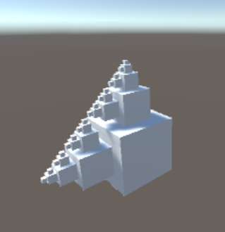
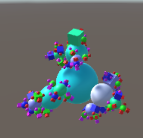

Fractals! My first encounter with the word was while playing Guild Wars 2. Instances emulating dungeons at a smaller scale.

At school I learned about their mathematical definition. "A curve or geometric figure, each part of which has the same statistical character as a whole". Fascinating stuff.

If I remember correctly, I can export Unity files to web. That could be a fun addition, letting viewers of the site manipulate the fractal.

<video preload="none" controls src="/videos/journal-entry4.2.mp4"></video>

<video preload="none" controls src="/videos/journal-entry4.3.mp4"></video>

Class notes

- To create a fractal we use the concept that its details can look exactly like the whole thing.
- We can apply this to an object's hierarchy in Unity. Start with the root object then add children to it that are smaller but otherwise identical.
- To make our fractal configurable we add a public mesh and material variable.
- **What's a mesh?** Mechanically a mesh is a construct used by the graphics hardware to draw complex stuff. A mesh contains at least a collection of points in 3D space plus a set of triangles (the most basic 2D shapes) defined by these points. The triangles constitute the surface of what the mesh represents.
- Materials are used to define visual properties of objects. They can range from very simple, like a constant color, to very complex. Materials consist of a shader and whatever data the shader needs. Shaders are scripts that tell the graphics card how an object's polygons should be drawn.
- **When is Start invoked?** It is called by Unity after the component is created, once it is active and just before the first time its Update method would be called.
- **How does AddComponent work?** The AddComponent method creates a new component of a certain type, attaches it to the game object, and returns a reference to it. That's why we can access the component's values. It is a generic method, a method template that can work with a range of types, declared between `<>`.
- We can use AddComponent to create the fractal's children.
- To prevent the recursive algorithm from producing a stack overflow or crash we introduce maximum depth. The initial instance will be zero. Its child will have a depth of 1 and so on until max depth is reached.
- **What's `this`?** The `this` keyword refers to the current object or struct whose method is being called. It's being used implicitly all the time when referring to stuff from the same class.
- Use `this` when you need to pass along a reference to the object itself.
- Parent-child relationship between game objects is defined by their transformation hierarchy. So a child needs to make the parent of its transform component equal to its fractal parent's transform.
- Coroutines are methods in which you can insert pause statements. The rest of the program continues while the method invocation is paused.
- **What's an enumerator?** Enumeration is the concept of going through some collection one item at a time, like looping over all elements in an array. An enumerator (or iterator) is an object that provides an interface for this functionality. `System.Collections.IEnumerator` describes such an interface.
- Coroutines use enumerators.
- **What does yield do?** The `yield` statement is used by iterators. To make enumeration possible you need to keep track of your progress. When you use yield, an enumerator object is created behind the scenes to take care of the tedious bits. You can yield other iterators.
- **How do coroutines work?** In Unity coroutines are iterators. When you pass it to the StartCoroutine method, it will get stored and gets asked for its next item every frame, until it is finished. The yield statements produce the items. The statements in between are side-effects of the iterator doing its job.
- The functions we are using are: $f(0) = 1,\ f(n) = 5 \times f(n-1) + 1$.
- **How does Random.Range work?** Random is a utility class that contains stuff to create random values. Its Range method can be used to generate a random value within some range.
- Range has two versions. You can call it with floats, in which case it returns a float between the minimum and maximum value, both inclusive. With integers it returns the minimum inclusive and maximum exclusive. Use case: `someArray[Random.Range(0, someArray.Length)]`.
- **How do arrays work?** Arrays are objects of fixed length that contain a linear sequence of variables.
- **How does a for loop work?** A for loop is a compact way of writing a loop that iterates over something.
- **What does Lerp do?** Lerp is shorthand for linear interpolation. Its typical signature is `Lerp(a, b, t)` and it computes $a + (b - a) \cdot t$, with t clamped to the 0-1 range. Multiple versions exist for various types, including floats, vectors and colors.
- **What is dynamic batching?** Dynamic batching is a form of draw call batching performed by Unity. It combines meshes that share the same material into larger meshes. Doing so reduces the amount of communication between the CPU and the GPU. You can enable or disable it via Edit/Project Settings/Player, in the Other Settings group. It only works for small meshes. In Unity, it works for cube, but not with sphere.
- For dynamic batching to work, the exact same material is used for multiple items. To fix that, we create one duplicate material per depth instead of per cube.
- **What's null?** The default value of a variable that's not a simple value is null. It means the variable doesn't reference anything. Trying to invoke or access anything from a variable that is null results in an error.

  Objects don't automatically cease to exist when setting a reference to them to null. Only when nobody is left referencing them will they be candidates for removal by the garbage collector.

  Works for private component fields but not public. Unity's serialization system would create an empty array for it, so it won't be null.
- **Why not make materials static?** Because it depends on the maximum depth, which can be different from fractal to fractal.
- **How do two-dimensional arrays work?** You can add a second dimension to an array by inserting a comma inside its brackets. You then also provide two indexes whenever you want to access one of the array's elements.

